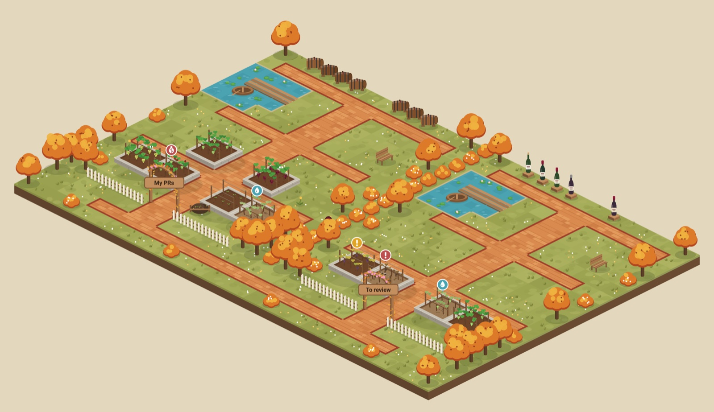
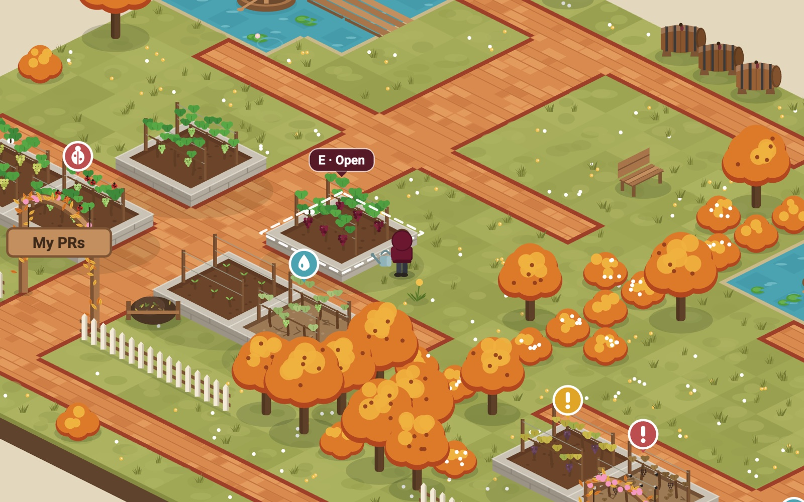
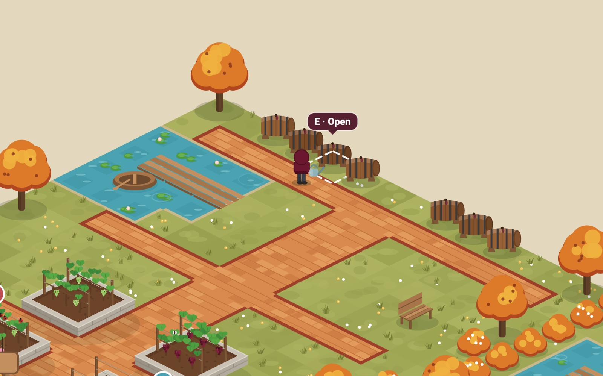
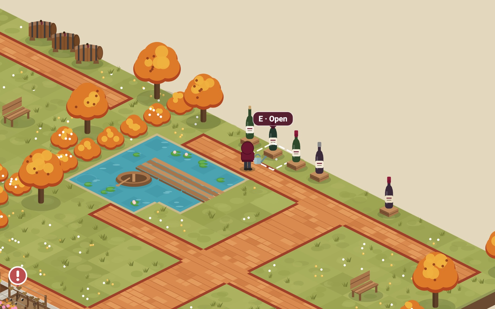

# PR Winery

An isometric winery where your GitHub work grows as grapevines. Walk a small
winemaker around with the keyboard, and open a vine, barrel or bottle to go to
its pull request.

Everything lives in one estate with two fenced vineyards side by side. Each
area has a vine-covered arch with its name on the sign, and a shared brick path
runs along both entrances.

- **My PRs**: your open PRs as vine beds, plus stale branches (weeds) and a
  pomace heap (closed without merging, last 30 days). Every PR of yours merged
  in the last 30 days becomes a **barrel**, stored in cellar rows at the back.
- **To review**: PRs waiting for your review as vine beds. Every PR you
  approved becomes a **bottle** in this area's cellar: corked while it waits to
  be merged, wax-sealed once merged, grey capsule if it was closed unmerged.



| Vines | Barrels | Bottles |
| --- | --- | --- |
|  |  |  |
| Open PRs grow as grapevines | Your merged PRs age in barrels | PRs you approved get bottled |

Screenshots use the mock data (`?mock=1`).

It's a static site (Vite + TypeScript + PixiJS v8). There's no backend: the app
calls the GitHub GraphQL API straight from your browser.

## Quick start

```bash
npm install
npm run dev
```

Open <http://localhost:5173/?mock=1> to try it with mock data. Without `?mock=1`,
the app asks for a GitHub token.

| Script | What it does |
| --- | --- |
| `npm run dev` | Dev server with hot reload |
| `npm test` | Unit tests (Vitest) |
| `npm run build` | Type-check and build to `dist/` |
| `npm run preview` | Serve the production build |

## GitHub token setup

PR Winery uses a **personal access token (classic)**.

1. Go to **GitHub → Settings → Developer settings → Personal access tokens →
   Tokens (classic) → Generate new token (classic)**. This link pre-fills the
   scopes: <https://github.com/settings/tokens/new?scopes=repo,read:org&description=PR%20Garden>
2. Pick an expiry (90 days is a sensible default).
3. Select the scopes:
   - `repo`: read pull requests, CI status and branches in private repos.
     If you only work in public repos, `public_repo` is enough.
   - `read:org`: lets the To review area see review requests made to your teams.
4. Generate the token, open PR Winery, click the ⚙ button and paste the token.

PR Winery only reads data, but classic tokens can't be limited to read-only.
The `repo` scope also grants write access, so treat the token like a password.
It is stored only in your browser's `localStorage` and is sent only to
`api.github.com`. Use **Forget token** in settings to remove it, and revoke it on
GitHub when you no longer need it.

One classic token covers every organisation you belong to.

### Organisations with SAML SSO

If an org enforces SAML single sign-on, the token must be authorised for that org.
On <https://github.com/settings/tokens>, click **Configure SSO** next to the
token, then **Authorize** next to the org. Until then, GitHub hides that org's
PRs, and the garden shows a notice saying some data is hidden.

### Weeds (stale branches)

In settings, list the repos to check (`owner/repo`, one per line). A branch
becomes a weed when its last commit is yours, it has no pull request, and it has
had no commits for 14 days or more.

## How vines are grown

**My PRs**, checked in this order:

| State | When | Look |
| --- | --- | --- |
| Budbreak | Draft | Bare trellis, tiny shoots |
| Pests | CI `FAILURE` or `ERROR` | Red beetles, bug marker |
| Thirsty | Unresolved threads where someone else spoke last | Cracked dry soil, pale leaves, water-drop marker |
| Ripe | Review decision `APPROVED` | Lush leaves, ripe bunches |
| Ripening | Anything else | Green leaves, unripe green grapes |

**Review requests**, based on how long ago your review was requested:

| State | When |
| --- | --- |
| Fresh | Under 24 hours |
| Drooping | 1–3 days (amber `!`) |
| Shrivelling | 3+ days (red `!`) |
| Thirsty | You reviewed before and new commits have arrived since |

PRs you approved leave the vineyard and become bottles (see below), unless new
commits arrive after your approval, which turns them back into a thirsty vine.

## The cellar

| Item | What | Search |
| --- | --- | --- |
| Barrel | Your PR, merged in the last 30 days | `is:pr author:@me is:merged merged:>=<30 days ago>` |
| Bottle | Someone else's PR whose latest review from you is an approval | `is:pr reviewed-by:@me -author:@me updated:>=<30 days ago>`, plus open PRs you approved that are still waiting to merge |

Each search returns up to 50 PRs. Cellar rows hold 8 items each and are added
at the back of the area as needed, newest first.

The To review area combines two searches: `review-requested:@me` and
`reviewed-by:@me -author:@me`. The second search finds PRs that need a re-review
and PRs you've already approved. PRs you reviewed with nothing new since (the
ball is in the author's court) are left out.

Data refreshes every 5 minutes, when the window regains focus, and when you
press **R**. The last result is cached, so the garden appears instantly on
reload. Rate limits, a bad token and being offline each show a notice, and the
cached garden stays on screen.

## Controls

| Key | Action |
| --- | --- |
| **W A S D** / arrows | Walk relative to the screen. Two keys together walk diagonally along the paths. |
| **Shift** | Run |
| **E**, **Space**, **Enter** | Open the highlighted vine, barrel or bottle on GitHub |
| **Tab**, **1**, **2** | Jump to an area's entrance (1 = My PRs, 2 = To review; Tab = the other area) |
| **L** | List view: the same data as plain links |
| **R** | Refresh |
| **\\** | Collapse the side panel |
| **?** | Controls overlay |
| **Esc** | Close overlays |

Mouse: click a tile or bed to walk there, hover a bed for details, and use the
wheel to zoom. Clicking a bed in the other area walks you out through one arch,
along the path and in through the other. The panel's "Needs care" list covers
both areas, and each row is tagged with its area.

Game keys never scroll the page, and they're ignored while you type in a text
field. When a button has keyboard focus, Tab, Space and Enter keep their usual
behaviour. Below 900 px wide, the panel becomes a bottom sheet and an on-screen
d-pad appears.

Accessibility: the game works fully from the keyboard, focus rings are visible,
the canvas has a descriptive `aria-label`, and **L** offers a plain list of
links. With `prefers-reduced-motion`, bobbing, swaying and camera easing are
turned off.

## Deploying to GitHub Pages

The repo includes `.github/workflows/deploy.yml`. It runs the tests, builds the
site and publishes `dist/` to Pages on every push to `main`.

1. Push the repo to GitHub.
2. In **Settings → Pages**, set **Source** to **GitHub Actions**.
3. Push to `main`, or run the workflow by hand from the **Actions** tab.

`vite.config.ts` uses `base: './'`, so the build works under any path, such as
`https://<you>.github.io/pr-garden/`.

## Project layout

```
src/
  github/   client.ts (GraphQL + errors), queries.ts, mapping.ts (pure state logic),
            store.ts (cache/refresh), mock.ts
  world/    template.ts (14×14 area), layout.ts (placement, proximity),
            compose.ts (both areas + shared path in one world),
            collision.ts, pathfinding.ts (A*)
  render/   iso.ts, drawGround.ts, drawBed.ts, drawProps.ts, drawGardener.ts,
            camera.ts, ambient.ts, scene.ts, palette.ts
  input/    keyboard.ts (key-state map), mouse.ts
  ui/       hud.ts, panel.ts, card.ts, listView.ts, settings.ts, help.ts, touch.ts
  game.ts   fixed-timestep loop (60 Hz update, render on rAF)
  main.ts   wiring
tests/      mapping, layout, compose, collision, pathfinding, client
```

All art is drawn procedurally with Pixi `Graphics`, seeded per bed so it stays
the same between renders. Drawing code lives only in `src/render/`, so it can be
swapped for sprite sheets later without touching game logic.
